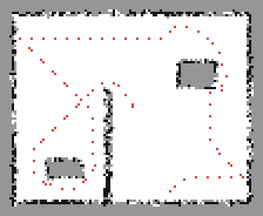

# loona-mapper

A companion service that builds a 2D occupancy-grid map of a room using a
Loona pet robot. It runs on your computer (not on the robot), drives Loona
around, and writes the map as PNG, JSON and ROS-compatible PGM/YAML.



*Simulated 5 x 4 m room with a couch, a table and a divider wall. White = free,
black = obstacle, grey = unknown, red = robot path.*

## Status

| Part | State |
|---|---|
| Mapping core (grid, frontier exploration, path planning, export) | Working, tested |
| Simulator (`loona-map sim`) | Working |
| **Loona adapter** (`adapters/loona.py`) | **Stub. Not connected to a real robot.** |

I don't know of a documented public control API for Loona, so the adapter is
a stub that documents exactly what the mapper needs. Until it is filled in,
the tool can only run in simulation.

Loona's app talks to it over Wi-Fi, but I haven't identified the protocol.
See [docs/finding-the-loona-protocol.md](docs/finding-the-loona-protocol.md)
and `loona-map discover <ip>` for how to find out.

## Quick start

```bash
pip install -e ".[dev]"
loona-map sim --out out        # explore the simulated room
pytest
loona-map render out/map.json out/map.png --scale 6
```

`loona-map run --host <ip>` runs against real hardware once `LoonaAdapter` is
implemented; until then it exits with a clear "not implemented" error.

## How it works

Loona has no lidar, so the mapper uses what a minimal robot offers: one
forward-facing distance reading plus the ability to turn and drive.

1. **Sweep**: rotate in place in 6 degree steps, taking a reading at each, to get a
   360 degree scan.
2. **Update**: each reading is ray-cast into a log-odds occupancy grid
   (5 cm cells). Free space along the beam, obstacle at the hit.
3. **Explore**: find *frontiers* (free cells next to never-observed space), plan
   a path (BFS on a grid inflated by the robot radius) to the nearest one,
   drive there in short sensed hops, sweep again. Repeat until no reachable
   frontier is left.

Everything robot-specific lives behind four methods in `robot.RobotAdapter`:
`pose()`, `rotate()`, `forward()`, `read_range()`.

## Wiring up a real Loona

Implement `LoonaAdapter` in `src/loona_mapper/adapters/loona.py`:

* `read_range()`: Loona's front distance/ToF sensor, in metres, `None` if
  nothing is in range. Set `max_range` to the sensor's true limit.
* `rotate()` / `forward()`: blocking turn-in-place and straight drive.
* `pose()`: dead-reckoned pose from wheel odometry or IMU, or integrate your
  own commanded moves.

Then **calibrate**: command a 1 m drive and a 360 degree turn, measure what
actually happened, and scale accordingly. Heading accuracy matters most.

## Known limitations

* **No SLAM.** The mapper trusts the pose the robot reports. In simulation
  with clean odometry the map is accurate (about 99.9% of free space found, about 98%
  of obstacle cells within 5 cm of a true wall). With simulated 5% motion
  error the map is badly smeared, and at 2% exploration may not finish. Real
  use needs good heading from an IMU/gyro, or scan matching and loop closure
  added on top (not implemented).
* **Single beam.** Thin or low obstacles (chair legs, cables) can be missed,
  and a real ToF sensor has a wider cone than the simulator's ray.
* **Static scene.** People and pets moving during a scan leave ghost obstacles.
* **2D only.** One height; no stairs/drop detection.
* Exploration is greedy nearest-frontier, not optimal.
